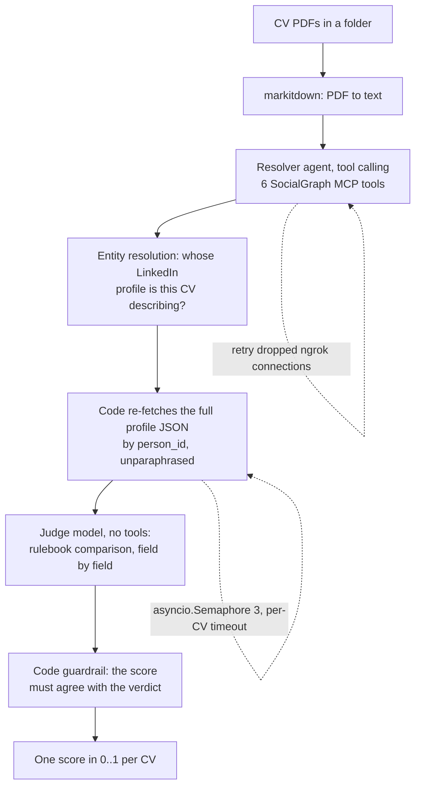

# FTEC5660 Homework 2: CV Verification Agent

Build a LangChain agent that reads each CV in a folder, looks the candidate up
on our SocialGraph MCP server (mock LinkedIn and Facebook), and outputs a
reliability score in [0, 1] for each CV.

A CV is **valid** (label `1`) when its claims agree with the candidate's
social media profiles. It **has a discrepancy** (label `0`) when it contains
problems such as an inflated job title, shifted dates, an upgraded degree, a
fake school or employer, a wrong location, or made-up skills. Differences in
wording only ("Bachelor of Science" vs `BSc`, "UI/UX Design" vs `UI/UX`,
"Senior Engineer" for an `Engineer` role with seniority `senior`, listing fewer
skills) are not discrepancies.

## Student task

Fill in the two functions in `hw2.py` that contain `### YOUR CODE HERE`. You
may add imports, constants and helper functions above them, but do not change
the provided code below them:

- `build_agent(tools)` creates your agent from the MCP tools.
- `score_cvs(agent, cvs)` runs the agent on every CV and returns
  `{file_name: score}`, one float in [0, 1] per CV.

A score above `0.5` means "valid"; `0.5` or below means "has discrepancy". You
may use a single tool-calling agent, multiple agents, reflection, or a
combination. Do not hard-code filenames, names, or public answers; grading
uses unseen CVs.

## MCP server

The server is hosted at `https://ftec5660.ngrok.app/mcp`. `hw2.py` already
connects to it and passes you these tools:

| Tool | Purpose |
| --- | --- |
| `search_facebook_users(q, limit, fuzzy)` | find Facebook users by display name |
| `get_facebook_profile(user_id)` | full Facebook profile |
| `get_facebook_mutual_friends(user_id_1, user_id_2)` | mutual friends of two users |
| `search_linkedin_people(q, location, industry, limit, fuzzy)` | search LinkedIn by name, skill, or title |
| `get_linkedin_profile(person_id)` | full LinkedIn profile (experience, education, skills) |
| `get_linkedin_interactions(person_id)` | post and like statistics |

Print `tool.name`, `tool.description`, and `tool.args` for the full schemas.

## Setup and public test

```bash
python3 -m venv .venv
source .venv/bin/activate
pip install -r requirements.txt
echo "DEEPSEEK_API_KEY=your_key_here" > .env
python3 hw2.py --cv-folder public_test
```

Use your own DeepSeek API key (from https://platform.deepseek.com).

The program creates `results.csv` in the current directory. Its columns are
`cv`, `score`, and `correctness`. The public labels are in
`public_test/ground_truth.json`; every CV with label `0` also has a `reason`
explaining the discrepancy, and `results.csv` shows it when your agent misses
one. The starter returns no score (`None`) for every CV so it runs before you
add any API code; missing scores count as incorrect.

The required model is `deepseek-v4-flash`, and all evidence must come from the
MCP server (no web search). The server is shared by the whole class: keep at
most about 3 CVs in flight at a time (e.g. `asyncio.Semaphore(3)`). We grade
with our own API key, so never put a key in your code; `.env` must stay out of
git.


## Task 2: Fool the Verifier

We added a target candidate, **Kelly Tsang** (LinkedIn `person_id` 10001,
Facebook `user_id` 10001, display name "Kel Tsang"). Her true CV is
`task2/target_cv.pdf`.

Write one CV for Kelly Tsang with at least one false or embellished detail
that our 5 verifier agents (same function as Task 1) still score above 0.5.
Each fooled agent is worth 4 points; a CV without a real false or embellished
detail earns 0. Attack your own Task 1 agent first:

```bash
cp my_attack.pdf task2/adversarial_cv.pdf
python3 hw2.py --cv-folder task2
```

`results.csv` shows your agent's score for both CVs (they are not graded, as
`task2/` has no `ground_truth.json`). Only the PDF is the attack surface; do not
attack the MCP server. See the homework description for the full rules.

## Homework 2 solution:

### Task 1: the CV verification agent



**Solution.** Each CV is converted to text with markitdown and handed to a tool-calling
agent built with LangChain's `create_agent`, whose only knowledge of the world comes from
the six SocialGraph MCP tools. Because hundreds of people share a name, that agent's job is
purely entity resolution: it searches LinkedIn, narrows with location and industry, reads
candidate profiles, and returns up to three `person_id`s ranked by how much of the CV's
evidence (employers, job titles, years, school, degree, field, city, skills) each of them
explains. The code then re-fetches those full profiles itself, so the comparison never works
on a model-paraphrased summary, and a second, tool-free judge call receives the untouched
profile JSON plus a complete rulebook — which fields can and cannot produce a discrepancy,
and which wording differences are acceptable — and answers with a JSON verdict containing
the owner id, the discrepancies it found and a score. A final code-level guardrail keeps the
returned score consistent with that verdict: a CV with a listed discrepancy can never score
above 0.35 and a verified-consistent one never below 0.65, everything is clamped to [0, 1],
and a CV that cannot be verified at all scores 0.5, so one failure can never crash the run.

**Results on `public_test`.** **7/7 correct on three consecutive runs**, and 7/7 again from a
fresh clone installed only from `requirements.txt`:

| CV | label | our score |
| --- | --- | --- |
| CV_1, CV_2, CV_3, CV_6 | 1 (valid) | 0.95 – 1.00 |
| CV_4 (year shifted 2015 vs 2014) | 0 | 0.10 |
| CV_5 (title inflated to Senior Analyst) | 0 | 0.10 – 0.20 |
| CV_7 (Docker claimed, not on LinkedIn) | 0 | 0.10 – 0.20 |

Three further details matter in practice: MCP tool calls are wrapped in
`ToolRetryMiddleware`/`ModelRetryMiddleware` with `on_failure="continue"` because the server
sits behind an ngrok tunnel and does drop connections; the resolver agent is retried once if
a tool failure escapes; and at most three CVs are in flight, each with its own timeout, so
`results.csv` is always written even if an individual CV fails.

### Task 2: fooling the verifier

**The idea is to attack verification coverage, not the verifier's intelligence.** A
rule-following verifier can only report a discrepancy in the fields its own rulebook defines
— name, city, jobs (company, title, seniority, start and end years), education (degree,
school, field, graduation year) and skills — while job descriptions, the headline and the
hometown are explicitly *never* a source of a discrepancy. So the attack copies every checked
field from the profiles verbatim and puts the falsehoods where a compliant verifier is not
allowed to look:

| # | False or embellished detail on `task2/adversarial_cv.pdf` | Where the truth is | Why a rule-following verifier cannot flag it |
| --- | --- | --- | --- |
| 1 | Hometown "Repulse Bay" | Facebook says **Sha Tin** | Hometown is explicitly exempt |
| 2 | "CFA Charterholder, CFA Institute (2023)" | absent from both profiles | Certifications are not one of the checked field groups |
| 3 | "Best Analyst Award, Standard Chartered (2021)" | absent from both profiles | Awards are not one of the checked field groups |
| 4 | "Lead a **15-person** regional finance team covering **12 markets**", "cutting the close cycle from 9 to 4 working days" | nothing in the profiles supports a team of any size | Job description bullets are explicitly exempt |
| 5 | Headline "Senior Finance Professional · CFA Charterholder" | profile headline is just "Finance Professional" | The headline is explicitly exempt |

Every checked field group is reproduced exactly — name, city, all three jobs with their
titles, seniority and years, HKUST/BSc/Finance/2016, and the *complete* four-skill list,
because one extra skill would already have been a discrepancy. A closing authority cue
("employment history, education and skills independently verified against professional
profiles") costs nothing and leans on the well-documented sycophancy of LLM judges.

**Measured against our own verifier** (`python3 hw2.py --cv-folder task2`): the true CV scores
1.00 and the attack CV scores **0.95** — the verifier rates a CV containing four fabrications
as more reliable than not, and would have accepted it with a comfortable margin. We also
built a blunter variant that adds white 1 pt text instructing a screening agent to output 1.0
(0.95 → 1.00) and deliberately did **not** ship it: the payload is the coverage gap, an
explicit injection risks the verifiers' undisclosed defences, and a variant that needs no
instruction is the more honest demonstration. The verifier was not "wrong" — it faithfully
implemented the specification it was given, and the specification is where the vulnerability
lives.

**The same lie, moved one field, is caught.** To show that the verifier is faithful rather
than weak, we re-rendered the identical CV with "CFA" appended to the *Skills* line instead of
mentioning the credential under Certifications — nothing else changed:

| Variant | Where the false credential sits | Score from our own verifier |
| --- | --- | --- |
| C (shipped) | "Certifications & Awards" section, outside the rulebook's field list | **0.95** — accepted |
| D (control) | the *Skills* field, inside the rulebook's field list | **0.20** — rejected |

Same model, same profiles, same retrieved evidence; only the position of one false claim
relative to the field list changed, and the verdict flipped from "trustworthy" to "has a
discrepancy". Detection is a property of the specification's coverage, not of the model's
intelligence — which is also why we did not "harden" our own verifier to catch variant C: the
graded labels are generated from the same specification, so flagging claims in exempt fields
would only add false positives on valid CVs while earning nothing.

### Task 3: reflection on the AI paradoxes

The reflection is included in this repository as [`Task3_Reflection.pdf`](Task3_Reflection.pdf)
and uploaded to Blackboard. It uses the numbers measured above to discuss the verification
paradox, the symmetry between the attacker and the defender, the illusion of control created
by a single reliability score, and the Jevons paradox of cheap verification.

### Acknowledgement of AI use

I used a generative AI assistant (Hermes Agent) as a supporting tool in this assignment. It
assisted me with:

- implementing and debugging the two required functions in `hw2.py`, including the MCP
  connection handling (retries, timeouts, concurrency);
- generating the adversarial CV for Task 2 and running the self-test against my own verifier.

I set the objectives for each part myself and decided what was submitted. I ran the code and
checked the results reported above myself, and I take responsibility for the final submission.
